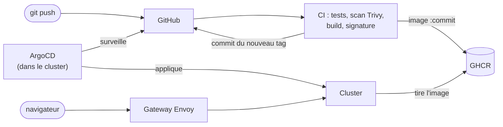

# k8s-ml-platform : une API de modèle ML sur Kubernetes, avec autoscaling, monitoring et pannes en direct

Une application qui sert un modèle scikit-learn (reconnaissance de chiffres 8x8) tourne sur Kubernetes : tu dessines un chiffre
dans ton navigateur, un pod te répond et te dit qui il est. Autour d'elle : autoscaling, sondes de santé, monitoring,
générateur de charge, une page temps réel qui montre le cluster réagir, et une chaîne complète de `git push` au déploiement
(CI GitHub Actions, GitOps avec ArgoCD, accès par Gateway API). L'application est volontairement minimale : le sujet du projet
est la plateforme.

| Phase | Contenu | État |
|---|---|---|
| 1 | Déploiement, Service, sondes, self-healing, rolling update | fait |
| 2 | HPA, PodDisruptionBudget, metrics-server, Prometheus, Grafana, alertes, Locust, plan du cluster en direct | fait |
| 3 | Atelier de chiffres (l'application), CI GitHub Actions (tests, scan, build, signature), GitOps avec ArgoCD, Kustomize, accès par Gateway API | ce dépôt |
| 4 | NetworkPolicies, secrets, vérification des signatures (Kyverno), Alertmanager, chaos testing, page GitHub Pages | à venir |

```
app/          ml-api : l'API (FastAPI) + l'atelier de chiffres (index.html) + tests ; le modèle est entraîné pendant le build
dashboard/    le "plan du cluster" : backend FastAPI + une page unique
deploy/       manifests de l'application (la "base" Kustomize) : namespace, Deployment, Service, HPA, PDB, dashboard et son RBAC
overlays/lab/ ce qui est propre à l'environnement : les images GHCR. C'est ce dossier qu'ArgoCD déploie
loadtest/     Locust (maître + travailleurs) dans son propre namespace
monitoring/   ServiceMonitor, alertes, dashboard Grafana (objets à appliquer APRÈS le chart Prometheus)
gateway/      Gateway API : la porte d'entrée (GatewayClass, Gateway) et une HTTPRoute par application
gitops/       ArgoCD : projet, application racine, une Application par composant de la plateforme
platform/     fichiers de values Helm : metrics-server, kube-prometheus-stack, argo-cd
scripts/      build.ps1 (images, mode manuel), screens.ps1 / gateway.ps1 (accès), set-owner.ps1 (configure ton compte GitHub)
.github/      workflows ci.yaml (images) et validate.yaml (manifestes), dependabot.yml
```

## Mise en route, mode manuel (phases 1 et 2, sans GitHub)

Prérequis : Docker Desktop avec Kubernetes en mode kind (3 nœuds si possible), `kubectl`, puis une fois :
`winget install Kubernetes.kind Helm.Helm`. Toutes les commandes se lancent depuis la racine du dépôt, en PowerShell.

```powershell
# 1. Images (construites puis chargées dans les nœuds kind)
./scripts/build.ps1

# 2. Plateforme : metrics-server (CPU/mémoire en direct, requis par le HPA) puis Prometheus + Grafana
helm repo add metrics-server https://kubernetes-sigs.github.io/metrics-server/
helm repo add prometheus-community https://prometheus-community.github.io/helm-charts
helm repo update
helm upgrade --install metrics-server metrics-server/metrics-server -n kube-system --version 3.14.0 -f platform/metrics-server-values.yaml
helm upgrade --install monitoring prometheus-community/kube-prometheus-stack -n monitoring --create-namespace --version 92.1.1 -f platform/kube-prometheus-stack-values.yaml
kubectl top nodes                                   # doit répondre après ~1 minute ; sinon voir "Dépannage"

# 3. Application, autoscaler et dashboard
kubectl apply -k deploy/                            # -k : passe par Kustomize (deploy/kustomization.yaml)
kubectl -n ml-platform get pods -w                  # 3 pods ml-api + le dashboard (Ctrl+C pour quitter)

# 4. Générateur de charge, puis monitoring de l'application (les CRD du chart Prometheus doivent exister)
kubectl apply -f loadtest/
kubectl apply -f monitoring/

# 5. Les écrans : atelier de chiffres (8001), plan du cluster (8000), Locust (8089), Grafana (3000)
./scripts/screens.ps1
```

Ce mode est le plus rapide pour jouer avec l'autoscaling. Pour la chaîne complète (CI, GitOps, Gateway), passe à la phase 3 plus bas ;
nettoie d'abord ce que tu viens d'installer (voir « Phase 3, étape 0 »).

Si tu ré-appliques `deploy/` (`kubectl apply -k deploy/`) sur le cluster de la phase 1, le nombre de pods retombe à 1 pendant quelques secondes
puis le HPA le remonte à 3 : le YAML n'a plus de `replicas`, et c'est exactement le piège qu'on évite (voir le commentaire
en tête de `deploy/10-deployment.yaml`).

Aperçu du plan du cluster sans cluster : `docker run --rm -p 8000:8000 -e DEMO=1 -e ENABLE_CHAOS=1 ml-dashboard:1.0.0`
puis http://localhost:8000. Un cluster simulé réagit aux mêmes boutons.
Aperçu de l'atelier de chiffres : `docker run --rm -p 8001:8000 ml-api:1.2.0` puis http://localhost:8001.

## L'atelier de chiffres (l'application)

C'est ce que « les utilisateurs » voient : une grille de 8×8 pixels où tu dessines un chiffre.

1. **Dessine** : le modèle ne voit pas ton trait mais la grille, soit 64 nombres entre 0 et 16 (le format des données d'entraînement).
   « Chiffre au hasard » charge un vrai chiffre du jeu de données, pour comparer la réponse à la vérité.
2. **Verdict** : le chiffre reconnu, la probabilité de chacun des dix chiffres (la moyenne des votes des 300 arbres), et surtout
   **le pod et le nœud qui ont répondu**, avec la version du code (le commit, quand l'image vient de la CI).
3. **Qui répond ?** : une carte par pod vu. « Rafale de 40 requêtes » ou « Flux continu » simulent des visiteurs ; la barre montre la
   répartition des 100 dernières réponses. Une carte apparaît quand l'autoscaler crée un pod, devient grisée (« muet depuis… ») quand
   un pod est supprimé depuis le plan du cluster, et les erreurs (503...) sont comptées.

Derrière `kubectl port-forward` un seul pod répond : le tunnel s'accroche à un pod au démarrage. Derrière la Gateway (phase 3),
Envoy répartit chaque requête : la rafale se répartit sur tous les pods. L'atelier te le dit s'il constate ce cas.
Le modèle travaille sur 8×8 pixels : il se trompe sur un trait de souris maladroit, c'est normal.

## Phase 3 : de `git push` au cluster



La CI ne parle jamais au cluster. Son dernier geste est un commit qui change le tag d'image dans `overlays/lab/kustomization.yaml` ;
ArgoCD, qui tourne dans le cluster, voit que Git et le cluster diffèrent et rapproche le second du premier. Aucun identifiant du
cluster dans GitHub, tout changement en production est un commit relisible, et le retour arrière est un `git revert`.

| Fichier | Rôle |
|---|---|
| `.github/workflows/ci.yaml` | tests -> build -> scan Trivy (bloque sur HIGH/CRITICAL corrigeables) -> push GHCR -> signature cosign -> commit du tag |
| `.github/workflows/validate.yaml` | rendu Kustomize + validation de chaque manifeste contre son schéma (CRD comprises) avec kubeconform |
| `.github/dependabot.yml` | PR automatiques pour les actions (SHA épinglés), images de base et dépendances Python |
| `deploy/kustomization.yaml`, `overlays/lab/` | base + overlay : l'overlay ne change que les images, la CI n'édite que ce fichier |
| `gitops/root.yaml`, `gitops/apps/` | pattern **app-of-apps** : une Application racine déploie le dossier d'Applications ; ajouter un composant = ajouter un fichier |
| `gitops/project.yaml` | périmètre ArgoCD : quels dépôts, quels clusters. Rien d'autre n'est autorisé |
| `gateway/` | Gateway API : `*.localhost:8080` -> une HTTPRoute par application, délai de requête désactivé pour le flux du plan du cluster |
| `platform/argocd-values.yaml` | installation d'ArgoCD, dont la règle de santé des Applications qui rend les vagues de synchro effectives |

Choix à connaître : les actions GitHub sont épinglées par **SHA de commit**, pas par tag. En mars 2026, les tags de `trivy-action` ont été
réécrits pour voler des secrets de CI ; un SHA ne peut pas être déplacé. Les images sont taguées par SHA de commit (jamais `:latest`),
donc un tag désigne toujours le même contenu et `imagePullPolicy: IfNotPresent` est sûr.

### Étape 0 : repartir propre (si tu viens du mode manuel)

ArgoCD doit être le seul propriétaire des objets. Les CRD de Prometheus restent dans le cluster, c'est voulu.

```powershell
kubectl delete -f monitoring/ -f loadtest/
kubectl delete -k deploy/
helm -n monitoring uninstall monitoring
helm -n kube-system uninstall metrics-server
kubectl delete ns monitoring loadtest --ignore-not-found
```

### Étape 1 : le dépôt GitHub et la CI

```powershell
# Dépôt PUBLIC (ArgoCD le lit sans identifiants, et c'est ton portfolio) puis, depuis la racine du projet :
./scripts/set-owner.ps1 -Owner <ton-identifiant-github>      # remplace GITHUB_OWNER dans overlays/ et gitops/
git init -b main ; git add . ; git commit -m "feat: plateforme ML sur Kubernetes"
gh repo create k8s-ml-platform --public --source . --push    # ou : crée le dépôt sur github.com, git remote add origin ..., git push -u origin main
```

Onglet **Actions** de GitHub : `ci` doit passer au vert (test, build des deux images, scan, push, signature, promotion). Aucun secret à
créer : GHCR et le push du tag utilisent le jeton fourni à chaque exécution. Puis :

```powershell
git pull                                  # récupère le commit « chore(deploy): images <sha> » fait par la CI
```

Pour que le cluster tire tes images sans identifiants, chaque paquet doit être public : github.com, ton profil, **Packages**, `ml-api`,
**Package settings**, **Change visibility**, Public ; idem `ml-dashboard` (si GitHub ne l'a pas déjà fait).

### Étape 2 : ArgoCD, puis tout le reste en une commande

```powershell
helm repo add argo https://argoproj.github.io/argo-helm ; helm repo update
helm upgrade --install argocd argo/argo-cd -n argocd --create-namespace --version 10.10.1 -f platform/argocd-values.yaml
kubectl -n argocd rollout status deploy/argocd-server

kubectl apply -f gitops/project.yaml -f gitops/repo-envoy-oci.yaml -f gitops/root.yaml
kubectl -n argocd get applications -w     # vague 0 : metrics-server, kube-prometheus-stack, envoy-gateway ; puis vague 1 : le reste (5 à 10 min)
```

Les Applications de la vague 0 installent les CRD et les contrôleurs ; ArgoCD attend qu'elles soient saines avant la vague 1
(application, charge, alertes, routes), qui en dépend. C'est la règle de santé de `platform/argocd-values.yaml` qui rend ça possible.

### Étape 3 : les écrans, derrière la Gateway

```powershell
./scripts/gateway.ps1                      # un seul tunnel (8080) vers Envoy ; il route selon le nom d'hôte
```

`http://app.localhost:8080` (atelier), `cluster.localhost` (plan du cluster), `locust.localhost`, `grafana.localhost` (admin / admin-lab),
`argocd.localhost` (admin, mot de passe ci-dessous). Les navigateurs résolvent `*.localhost` vers ta machine ; avec `curl`, ajoute
`--resolve app.localhost:8080:127.0.0.1`.

```powershell
$p = kubectl -n argocd get secret argocd-initial-admin-secret -o jsonpath="{.data.password}"
[Text.Encoding]::UTF8.GetString([Convert]::FromBase64String($p))
```

## Lire le plan du cluster

- Chaque **voie** est un nœud ; chaque **cadran** est un pod. Les points qui descendent sont des requêtes.
- Les **graduations** du cadran s'allument avec le CPU consommé par rapport au CPU demandé. Le repère long est la cible de
  l'autoscaler (50 %). Chaque graduation au-delà passe de l'orange au rouge.
- Un cercle en **pointillés** est un pod qui n'est pas encore prêt (création, démarrage). Rouge : arrêt ou erreur.
- En bas : la règle de l'autoscaler (cases pleines = pods prêts, pointillés = pods voulus), les courbes des trois dernières
  minutes, et le journal des événements. Passe la souris sur un pod pour le détail (CPU en millicores, mémoire, latence).

## Expériences

Garde le plan du cluster ouvert à côté d'un terminal. Chaque expérience dit ce qui doit se passer et où le vérifier.

### A. Pannes (boutons « Pannes »)

| Bouton | Ce qui se passe | À observer |
|---|---|---|
| Supprimer un pod | `kubectl delete pod` : le ReplicaSet constate qu'il manque un pod et en recrée un | arrêt en cours, puis un nouveau pod : création, démarre, prêt |
| Faire planter un pod | le processus meurt (`/crash`) : le kubelet redémarre le **même** pod | compteur de redémarrages +1, journal « redémarré » |
| Rendre un pod malade | `/healthz` répond 500 : la `livenessProbe` échoue 3 fois (~30 s), puis le conteneur est tué | le pod reste « prêt » pendant ce délai : la readiness, elle, répond encore |

```powershell
kubectl -n ml-platform get pods -w
kubectl -n ml-platform describe pod <pod>           # section Events tout en bas : la première chose à lire en cas de souci
```

### B. Heure de pointe : l'autoscaler en action

Clique sur **Heure de pointe** (60 utilisateurs, ~30 requêtes/s). Dans l'ordre, tu dois voir : le CPU moyen dépasser la cible,
le journal annoncer « Autoscaler : 3 → N pods souhaités » (≈15 à 30 s), de nouveaux pods en pointillés, puis la charge se répartir
et le CPU revenir vers 50 %. Après **Arrêter la charge**, la redescente prend 1 à 2 minutes (1 pod toutes les 30 s).

```powershell
kubectl -n ml-platform get hpa ml-api -w
kubectl top pods -n ml-platform
kubectl -n ml-platform describe hpa ml-api          # Conditions : AbleToScale, ScalingActive, ScalingLimited
```

### C. Black Friday : quand le cluster n'y arrive plus

Clique sur **Black Friday** (400 utilisateurs, ~200 requêtes/s). L'autoscaler monte jusqu'à `maxReplicas` (8) puis ne peut plus
rien ajouter : le plan affiche « Plafond atteint ». Si 8 pods ne suffisent pas à servir cette charge (~170 requêtes/s avec les
19 ms de CPU par requête que j'ai mesurés ; plus sur un PC plus rapide), les pods tapent dans leur limite CPU (bridage) et la
latence décolle : regarde « Bridage CPU » et « Latence » dans Grafana. Si ton PC absorbe tout sans broncher, augmente les
utilisateurs de `blackfriday` dans `PROFILES`. Après 2 minutes au plafond, l'alerte `MlApiAutoscalerAtMax` se déclenche :

```powershell
kubectl -n monitoring port-forward svc/monitoring-kube-prometheus-prometheus 9090:9090    # puis http://localhost:9090/alerts
```

À essayer : monte `maxReplicas` dans `deploy/30-hpa.yaml`, applique, relance. Si des pods restent en attente d'un nœud (voie
orange), c'est que Docker Desktop n'a plus de CPU ou de mémoire à donner : augmente ses ressources, ou baisse `maxReplicas`.
Les chiffres des profils de charge sont dans `PROFILES` (`dashboard/main.py`) ; ils dépendent de la vitesse de ta machine.

### D. Le piège du keep-alive : pourquoi plus de pods ne suffit pas toujours

kube-proxy répartit le trafic **par connexion**, pas par requête. Des clients qui gardent leur connexion ouverte restent collés au
même pod : les pods créés par l'autoscaler ne reçoivent presque rien.

```powershell
kubectl -n loadtest set env deploy/locust-worker KEEPALIVE=1      # les utilisateurs gardent leur connexion
# relance « Heure de pointe » : les nouveaux pods doivent rester à ~0 req/s pendant que les 3 premiers saturent
kubectl -n loadtest set env deploy/locust-worker KEEPALIVE-       # retour à une connexion par requête
```

En production on règle ça avec un équilibreur de niveau 7 (Envoy, un service mesh) ou des clients qui renouvellent leurs connexions :
c'est ce que fait la Gateway de la phase 3. Rafale de l'atelier derrière `port-forward` (un pod) puis derrière `app.localhost:8080` (tous) : même navigateur, même connexion, résultat opposé.

*En mode GitOps*, ArgoCD annule `kubectl set env` en quelques secondes (selfHeal) : fais le changement dans Git. Ajoute sous `containers:` du Deployment
`locust-worker` dans `loadtest/locust.yaml` : `env: [{name: KEEPALIVE, value: "1"}]`, puis commit et push ; retire-le pour revenir en arrière.

### E. Maintenance d'un nœud : le PodDisruptionBudget

```powershell
kubectl get nodes
kubectl drain <un-worker> --ignore-daemonsets --delete-emptydir-data
kubectl uncordon <un-worker>
kubectl -n ml-platform rollout restart deploy/ml-api              # Kubernetes ne rééquilibre pas tout seul : on re-répartit
```

Le drain évince les pods un par un et attend que leurs remplaçants soient prêts : jamais moins de 2 pods disponibles
(`deploy/40-pdb.yaml`). La voie du nœud se vide dans le plan.

### F. Incident à diagnostiquer : un déploiement qui échoue

```powershell
kubectl -n ml-platform set resources deploy/ml-api --limits=memory=128Mi
```

*En mode GitOps*, ArgoCD annulerait cette commande : fais plutôt l'incident par Git. Mets `memory: 128Mi` dans les `limits` de `deploy/10-deployment.yaml`,
commit, push : ArgoCD déploie, le rollout bloque, et le retour arrière est `git revert` au lieu de `rollout undo`.

Le pod consomme ~180 Mio : avec 128 Mio, le nouveau pod doit être tué dès son démarrage. Observe : le plan montre un pod en boucle
de crash et le journal écrit « mémoire dépassée », **mais le service continue** car `maxUnavailable: 0` garde les anciens pods
tant que le nouveau n'est pas prêt. Diagnostic, puis retour arrière :

```powershell
kubectl -n ml-platform rollout status deploy/ml-api --timeout=60s     # n'aboutit pas
kubectl -n ml-platform describe pod <nouveau-pod>                      # Last State : Terminated, Reason: OOMKilled, Exit Code: 137
kubectl -n ml-platform rollout undo deploy/ml-api
```

### G. Du commit au pod (phase 3)

Change le titre dans `app/index.html`, puis `git commit` et `git push`. Dans l'ordre : l'onglet Actions (tests, build, scan, push, signature,
promotion) ; `git pull` pour voir le commit de la CI ; dans ArgoCD, `ml-platform` passe `OutOfSync` puis `Synced` ; dans le plan du
cluster, un rolling update (nouveaux pods en pointillés, anciens arrêtés un à un, jamais moins de pods prêts) ; enfin l'atelier affiche le
nouveau titre et, sous le verdict, le commit du code qui répond.

### H. La dérive est corrigée toute seule

```powershell
kubectl -n ml-platform delete hpa ml-api
kubectl -n ml-platform get hpa -w          # ArgoCD constate l'écart avec Git et recrée l'objet en quelques secondes (selfHeal)
```

### I. Retour arrière par Git

```powershell
git pull ; git log --oneline -5            # repère le commit « chore(deploy): images ... » à annuler
git revert --no-edit <sha-du-commit> ; git push
```

La CI ne repart pas (le commit ne touche que `overlays/`) ; ArgoCD redéploie les anciens tags, qui existent toujours dans GHCR puisqu'ils
sont immuables. Le prochain push de code promeut de nouveau le plus récent.

## Ce que tu viens de voir, et où c'est écrit

| Comportement | Objet Kubernetes | Fichier |
|---|---|---|
| Un pod meurt, un autre le remplace | Deployment, ReplicaSet | `deploy/10-deployment.yaml` |
| Un conteneur bloqué est redémarré, un pod pas prêt ne reçoit rien | liveness, readiness, startup probes | `deploy/10-deployment.yaml` |
| Le nombre de pods suit la charge | HorizontalPodAutoscaler + metrics-server | `deploy/30-hpa.yaml`, `platform/metrics-server-values.yaml` |
| Une mise à jour ratée ne coupe pas le service | stratégie RollingUpdate (`maxUnavailable: 0`) | `deploy/10-deployment.yaml` |
| Une maintenance ne vide pas le service | PodDisruptionBudget | `deploy/40-pdb.yaml` |
| Les pods sont répartis sur les nœuds | topologySpreadConstraints | `deploy/10-deployment.yaml` |
| Le dashboard lit le cluster sans en être administrateur | ServiceAccount, Role, RoleBinding | `deploy/50-dashboard-rbac.yaml` |
| Les métriques sont collectées et alertées | ServiceMonitor, PrometheusRule, Grafana | `monitoring/` |
| La charge est simulée depuis l'intérieur du cluster | Locust maître / travailleurs | `loadtest/locust.yaml` |
| Le pod sait sur quel nœud il tourne | Downward API (`fieldRef: spec.nodeName`) | `deploy/10-deployment.yaml` |
| Un même YAML sert plusieurs environnements | Kustomize : base + overlay, transformer `images` | `deploy/kustomization.yaml`, `overlays/lab/` |
| Le cluster se met à jour depuis Git, et annule les modifications manuelles | ArgoCD : Application, `selfHeal`, `prune` | `gitops/apps/` |
| Les composants s'installent dans le bon ordre | sync-waves + santé des Applications | `gitops/apps/`, `platform/argocd-values.yaml` |
| Des CRD énormes s'appliquent sans erreur | Server-Side Apply | `gitops/apps/kube-prometheus-stack.yaml` |
| Plusieurs applications derrière un seul point d'entrée, avec répartition par requête | Gateway API : GatewayClass, Gateway, HTTPRoute | `gateway/` |
| Une image vulnérable n'est jamais publiée, et chaque image est traçable | Trivy avant push, signature cosign, tags par SHA | `.github/workflows/ci.yaml` |

## Dépannage

| Symptôme | Cause probable et vérification |
|---|---|
| `ErrImagePull` / `ImagePullBackOff` sur ml-api ou ml-dashboard (mode manuel) | image non chargée dans kind : relance `./scripts/build.ps1` |
| `ImagePullBackOff` avec une image `ghcr.io/...` (GitOps) | tag `pending-first-ci-run` : la CI n'a pas encore tourné (voir Actions, puis `git pull`) ; sinon le paquet GHCR est privé : passe-le en public |
| La CI échoue à l'étape Trivy | lis le tableau : une CVE HIGH/CRITICAL corrigeable. Monte la dépendance (ou l'image de base) ; si elle est inoffensive, déclare-la dans `.trivyignore` avec la raison |
| `kubectl -n argocd get applications` : une Application reste `Progressing` ou `Degraded` | `kubectl -n argocd describe application <nom>` (section Conditions), ou l'interface ArgoCD ; la vague 1 attend que la vague 0 soit saine |
| `envoy-gateway` : erreur de dépôt OCI | `gitops/repo-envoy-oci.yaml` appliqué ? Docker Hub atteignable ? `registry-1.docker.io/envoyproxy` est l'URL attendue par ArgoCD, pas `docker.io` |
| `app.localhost:8080` ne répond pas | `./scripts/gateway.ps1` lancé ? `kubectl -n envoy-gateway-system get gateway lab` (PROGRAMMED doit valoir True) et `kubectl -n ml-platform describe httproute ml-api` (Accepted) |
| `kubectl get hpa` affiche `<unknown>` | metrics-server pas prêt : `kubectl get apiservice v1beta1.metrics.k8s.io` et `kubectl -n kube-system logs deploy/metrics-server` |
| Le plan affiche « Lecture du cluster impossible » | droits RBAC : `kubectl auth can-i list pods -n ml-platform --as=system:serviceaccount:ml-platform:ml-dashboard` |
| Un bouton « Charge » répond « Locust injoignable » | `kubectl -n loadtest get pods` : le maître et les 2 travailleurs doivent tourner ; l'interface Locust affiche les travailleurs connectés |
| Pas de cibles dans Prometheus | `kubectl apply -f monitoring/` fait après le chart (ou l'Application `monitoring-config` synchronisée) ; puis http://localhost:9090/targets |
| Grafana : le dashboard « ml-api » est absent | `kubectl -n monitoring get cm -l grafana_dashboard=1` ; Grafana peut mettre une minute à le charger |
| Noms de Services différents pour Grafana ou Prometheus | `kubectl -n monitoring get svc` : le préfixe suit le nom de la release Helm (`monitoring`) |
| `kind load` échoue avec « content digest not found » | Docker Desktop avec le magasin d'images containerd : `docker save ml-api:1.2.0 -o ml-api.tar` puis `kind load image-archive ml-api.tar` |

## Limites connues de ce lab

- Mode manuel : les images sont chargées à la main dans kind. Le mode GitOps passe par GHCR et la CI.
- metrics-server tourne avec `--kubelet-insecure-tls` (certificats kubelet auto-signés de kind), Grafana avec un mot de passe en clair,
  et l'API expose `/crash` et `/sick` : tout ça est signalé dans les fichiers et n'a pas sa place en production.
- Pas d'Ingress : la maintenance d'ingress-nginx s'est arrêtée en mars 2026 (plus de correctifs de sécurité) et Kubernetes recommande la
  Gateway API, utilisée ici. Elle est en HTTP simple (pas de TLS : cert-manager en production) et atteinte par un `port-forward` vers Envoy,
  car kind n'a pas de LoadBalancer ; sur un vrai cluster, le Service d'Envoy serait de type LoadBalancer.
- La CI pousse le commit de promotion directement sur `main`. Avec une protection de branche, il faudrait un jeton dédié ou une PR automatique.
- Le mot de passe initial d'ArgoCD est le secret généré à l'installation ; en production : SSO, et suppression de ce secret.
- Les signatures cosign sont produites mais pas vérifiées à l'admission : c'est une politique Kyverno, prévue en phase 4.
- Pas encore de NetworkPolicies : tous les pods peuvent se parler.
